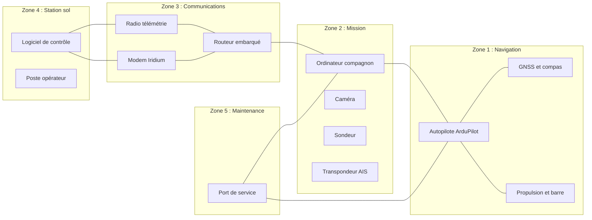

# T.R.I.T.O.N

**Threat & Risk Integrated Toolkit for Onboard Naval systems**

**Analyse de risques et dossier de sécurité d'un drone de surface naval, du security by design jusqu'à l'homologation.**
**Risk analysis and security case for a naval surface drone, from security by design to accreditation.**

🇫🇷 [Français](#français) · 🇬🇧 [English](#english)

---

## Français

### Pourquoi ce projet

Dans l'industrie de défense, la sécurité d'un produit se décide bien avant sa construction. Les risques sont analysés sur plan puis traduits en exigences que les ingénieurs devront tenir. Le tout aboutit à un dossier qui permet à une autorité d'accepter les risques résiduels en connaissance de cause.

Ce travail reste presque toujours confidentiel et on ne trouve quasiment aucun exemple public complet sur un système embarqué. TRITON est ma tentative de combler ce manque. Je prends un système naval réaliste et je déroule sa démarche de sécurité de bout en bout, comme je le ferais en mission. Les analyses, les choix et les hésitations sont publiés avec l'outillage qui les accompagne.

### Le système étudié : TRITON-01

TRITON-01 est un petit drone de surface autonome (USV) destiné à la surveillance portuaire et à la reconnaissance côtière. Le produit est fictif mais ses briques sont réelles et documentées publiquement.

| Fonction | Composant retenu |
|---|---|
| Pilote automatique | ArduPilot (firmware Rover, mode bateau) |
| Calcul mission | Ordinateur compagnon sous Linux (type Raspberry Pi CM4) |
| Positionnement | Récepteur GNSS multiconstellation et compas |
| Identification | Transpondeur AIS classe B |
| Capteurs | Caméra jour/nuit et sondeur |
| Liaison principale | Radio de télémétrie (MAVLink) et liaison vidéo IP |
| Liaison de secours | Modem satellite Iridium SBD |
| Opération | Station sol (logiciel de contrôle et poste opérateur) |
| Maintenance | Port de service filaire et mises à jour du firmware |

Le drone existe en deux variantes. La version civile TRITON-01 C est vendue aux autorités portuaires et entre donc dans le périmètre du Cyber Resilience Act. La version défense TRITON-01 D en sort, puisque le règlement exclut les produits conçus pour la défense ou la sécurité nationale. Sa mise en service passe alors par une homologation. Ce double cas est volontaire : beaucoup de produits réels sont duaux et il faut savoir quelle règle s'applique à quelle version.

### Architecture et zones



Le découpage suit IEC 62443-3-2 et chaque zone reçoit un niveau de sécurité cible (SL-T). Ces niveaux sont provisoires : l'analyse de risques devra les justifier ou les corriger.

| Zone | Contenu | SL-T |
|---|---|---|
| Z1 Navigation | Autopilote, GNSS, propulsion | 3 |
| Z2 Mission | Ordinateur compagnon, capteurs, AIS | 2 |
| Z3 Communications | Radio, satellite, routeur | 3 |
| Z4 Station sol | Contrôle et opérateur | 3 |
| Z5 Maintenance | Port de service, mises à jour | 2 |

### Démarche et référentiels

L'analyse de risques globale suit EBIOS Risk Manager, la méthode de l'ANSSI, sur ses cinq ateliers. La partie embarquée fait en plus l'objet d'une TARA selon ISO/SAE 21434 qui descend au niveau des actifs techniques et des chemins d'attaque.

L'architecture et les exigences reposent sur IEC 62443. La partie 3-2 sert au découpage en zones et conduits. Les parties 3-3 et 4-2 fournissent les exigences système et composant, et la partie 4-1 cadre le cycle de développement. Chaque exigence retenue est reliée aux risques qu'elle couvre.

La variante civile est confrontée au Cyber Resilience Act (règlement UE 2024/2847). On y vérifie l'applicabilité et la catégorie du produit, puis l'écart avec les exigences essentielles de l'annexe I. La variante défense suit la démarche d'homologation de l'ANSSI jusqu'à un projet de décision qui expose les risques résiduels. ISO/IEC 27001 couvre enfin ce qui entoure le produit, comme les fournisseurs, la maintenance ou la gestion des incidents.

Le dossier se termine sur ce que tout cela change dans la conception du drone. Le démarrage sécurisé, la signature du firmware et des messages MAVLink 2 ou le durcissement du port de service n'arrivent pas par principe : chaque mesure est justifiée par l'analyse qui la précède. Tout ce travail se trouve dans `docs/`.

### Risk as code

Le système et son analyse sont décrits en YAML dans `model/` et versionnés comme du code. Une modification de l'analyse se relit donc dans un diff. Un risque laissé sans mesure ou une exigence qui ne couvre rien se détecte automatiquement. Et les tableaux du dossier sont générés au lieu d'être recopiés à la main.

### Outillage

`tool/` contient une petite CLI qui travaille sur ce modèle.

```bash
triton validate model/
triton trace --gaps
triton cra --variant civil
triton sbom firmware/
triton report --format md
```

`validate` vérifie le modèle. `trace` construit la matrice qui relie menaces, risques, exigences et mesures en signalant les trous. `cra` déroule l'analyse d'applicabilité puis la checklist de l'annexe I. `sbom` produit la nomenclature logicielle CycloneDX d'ArduPilot et de l'OS du compagnon avant de chercher les vulnérabilités connues. `report` assemble enfin le dossier.

L'outil ne prétend pas dire si un produit est conforme, ce qui reste une affaire de jugement. Il sert à garder l'analyse propre et traçable.

### Démonstration

`sim/` lance ArduPilot en simulation (SITL) avec une station sol pour montrer le système en fonctionnement sans aucun matériel. J'y ajouterai ensuite des scénarios d'attaque tirés de l'analyse, comme l'usurpation GNSS, l'injection MAVLink ou la perte de liaison, pour vérifier que les mesures prévues tiennent.

### Organisation du dépôt

```
triton/
├── docs/        dossier de sécurité
├── model/       système et analyse en YAML
├── tool/        CLI triton
├── sim/         simulation ArduPilot SITL
└── README.md
```

### Avancement

Le projet démarre. La description du système est en cours et servira de base à l'atelier 1 d'EBIOS RM. Les autres livrables suivront dans l'ordre du dossier et l'outillage se construira au fil de l'eau.

### À savoir

TRITON-01 n'existe pas. Aucune information de ce dépôt ne vient d'un client, d'un employeur ou d'un programme réel, et tout repose sur des sources publiques. Les niveaux de risque et les choix d'architecture sont les miens et je les assume comme tels. Les retours et les désaccords sont les bienvenus en issue.

### Auteur

Je m'appelle **Mathias EMON** (Mat4Shell). Je suis étudiant en architecture systèmes, réseaux et sécurité à l'ESGI et analyste SOC en alternance, et je me spécialise dans la cybersécurité maritime et industrielle.
[mat4shell.com](https://mat4shell.com)

### Licence

Le code (`tool/` et `sim/`) est sous licence MIT. Voir [LICENSE](LICENSE).
La documentation et le modèle de risque (`docs/` et `model/`) sont sous licence CC BY-NC-SA 4.0. Voir [LICENSE-docs](LICENSE-docs).
Pour un usage commercial de la documentation, contactez-moi.

---

## English

### Why this project

In the defense industry a product's security is decided long before it gets built. Risks are analysed on paper and turned into requirements the engineers will have to meet. It all ends up in a security case that lets an authority accept the residual risks knowingly.

This work is almost always confidential and there are hardly any complete public examples on an embedded system. TRITON is my attempt to fill that gap. I take a realistic naval system and carry its security process from start to finish the way I would on a real assignment. The analyses, the choices and the doubts are published along with the tooling behind them.

### The system: TRITON-01

TRITON-01 is a small autonomous unmanned surface vessel (USV) built for harbour surveillance and coastal reconnaissance. The product is fictional but its building blocks are real and publicly documented.

| Function | Component |
|---|---|
| Autopilot | ArduPilot (Rover firmware, boat mode) |
| Mission computing | Linux companion computer (Raspberry Pi CM4 class) |
| Positioning | Multi constellation GNSS receiver and compass |
| Identification | Class B AIS transponder |
| Sensors | Day/night camera and echo sounder |
| Main link | Telemetry radio (MAVLink) and IP video link |
| Backup link | Iridium SBD satellite modem |
| Operations | Ground control station and operator console |
| Maintenance | Wired service port and firmware updates |

The drone comes in two variants. The civilian TRITON-01 C is sold to port authorities so it falls under the Cyber Resilience Act. The defense TRITON-01 D does not, since the regulation excludes products built for defense or national security, and it has to go through accreditation before being put into service. This is on purpose: many real products are dual use and you need to know which rule applies to which version.

### Architecture and zones

The diagram is in the French section. The breakdown follows IEC 62443-3-2 and each zone gets a target security level (SL-T). These levels are provisional and the risk analysis will either back them up or change them.

| Zone | Content | SL-T |
|---|---|---|
| Z1 Navigation | Autopilot, GNSS, propulsion | 3 |
| Z2 Mission | Companion computer, sensors, AIS | 2 |
| Z3 Communications | Radio, satellite, router | 3 |
| Z4 Ground station | Control and operator | 3 |
| Z5 Maintenance | Service port, updates | 2 |

### Approach and frameworks

The overall risk analysis follows EBIOS Risk Manager, the ANSSI method, through its five workshops. The embedded side also gets a TARA based on ISO/SAE 21434 that goes down to technical assets and attack paths.

Architecture and requirements rely on IEC 62443. Part 3-2 drives the zones and conduits. Parts 3-3 and 4-2 provide the system and component requirements while part 4-1 frames the development lifecycle. Every requirement is linked to the risks it covers.

The civilian variant is checked against the Cyber Resilience Act (EU Regulation 2024/2847), from applicability and product category down to the gaps with the Annex I essential requirements. The defense variant follows the ANSSI accreditation process up to a draft decision that lays out the residual risks. ISO/IEC 27001 covers what surrounds the product, such as suppliers, maintenance or incident handling.

The security case ends with what all of this changes in the drone's design. Secure boot, signed firmware and MAVLink 2 messages or a hardened service port are not there by default: each control is backed by the analysis that comes before it. All of this lives in `docs/`.

### Risk as code

The system and its analysis are described in YAML under `model/` and versioned like code. A change to the analysis can be reviewed in a diff. A risk left without a control or a requirement that covers nothing gets caught automatically. And the tables of the security case are generated instead of being copied by hand.

### Tooling

`tool/` holds a small CLI that works on this model (commands are shown in the French section). `validate` checks the model and `trace` builds the matrix linking threats, risks, requirements and controls while flagging the gaps. `cra` walks through applicability and then the Annex I checklist. `sbom` produces a CycloneDX SBOM for ArduPilot and the companion OS before looking for known vulnerabilities. `report` finally puts the security case together.

The tool does not claim to tell whether a product is compliant. That stays a matter of judgement. It is there to keep the analysis clean and traceable.

### Demo

`sim/` runs ArduPilot in simulation (SITL) with a ground station so the system can be shown running with no hardware at all. Attack scenarios taken from the analysis will come later, such as GNSS spoofing, MAVLink injection or link loss, to check that the planned controls hold.

### Status

The project is just starting. The system description is in progress and will feed the first EBIOS RM workshop. The other deliverables will follow in the order of the security case and the tooling will grow along the way.

### Disclaimer

TRITON-01 does not exist. Nothing in this repository comes from a client, an employer or a real programme and everything is based on public sources. Risk levels and design choices are my own and I stand by them as such. Feedback and disagreement are welcome as issues.

### Author

I'm **Mathias EMON** (Mat4Shell), a systems, network and security architecture student at ESGI and an apprentice SOC analyst. I specialise in maritime and industrial cybersecurity.
[mat4shell.com](https://mat4shell.com)

### License

The code (`tool/` and `sim/`) is under the MIT license. See [LICENSE](LICENSE).
The documentation and risk model (`docs/` and `model/`) are under CC BY-NC-SA 4.0. See [LICENSE-docs](LICENSE-docs).
For commercial use of the documentation please get in touch.
