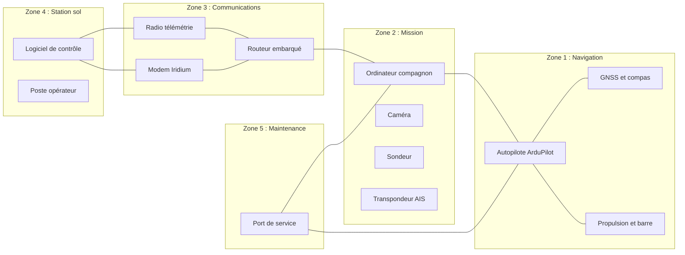

# TRITON

**Threat & Risk Integrated Toolkit for Onboard Naval systems**

**Analyse de risques et dossier de sécurité d'un drone de surface naval, du security by design jusqu'à l'homologation.**
**Risk analysis and security case for a naval surface drone, from security by design to accreditation.**

🇫🇷 [Français](#français) · 🇬🇧 [English](#english)

---

## Français

### Pourquoi ce projet

Dans l'industrie de défense, la cybersécurité d'un produit se joue bien avant qu'il soit construit. On analyse les risques sur plan. On écrit des exigences que les ingénieurs vont devoir tenir. On monte un dossier qui permettra à une autorité d'accepter les risques résiduels en connaissance de cause.

Ce travail reste presque toujours confidentiel. On ne trouve quasiment aucun exemple public et complet d'une démarche de ce type sur un système embarqué.

TRITON est ma tentative de combler ce manque. Je prends un système naval réaliste et je mène sa démarche de sécurité de bout en bout, comme je le ferais en mission. Tout est publié : les analyses, les choix, les hésitations et l'outillage qui va avec.

### Le système étudié : TRITON-01

TRITON-01 est un **drone de surface autonome (USV)** de petite taille. Il sert à la surveillance portuaire et à la reconnaissance côtière. Le produit est fictif. Ses briques sont réelles et documentées publiquement.

| Fonction | Composant retenu |
|---|---|
| Pilote automatique | ArduPilot (firmware Rover, mode bateau) |
| Calcul mission | Ordinateur compagnon sous Linux (type Raspberry Pi CM4) |
| Positionnement | Récepteur GNSS multiconstellation et compas |
| Identification | Transpondeur AIS classe B |
| Capteurs | Caméra jour/nuit et sondeur |
| Liaison principale | Radio de télémétrie (MAVLink) et liaison vidéo IP |
| Liaison de secours | Modem satellite Iridium SBD |
| Opération | Station sol (logiciel de contrôle et poste opérateur) |
| Maintenance | Port de service filaire et mises à jour du firmware |

Deux variantes sont étudiées :

* **TRITON-01 C**, la version civile vendue aux autorités portuaires. Elle entre dans le périmètre du Cyber Resilience Act.
* **TRITON-01 D**, la version défense. Elle sort du périmètre du CRA, qui exclut les produits conçus pour la défense ou la sécurité nationale. Sa mise en service passe par une homologation.

Ce double cas est volontaire. Dans la vraie vie beaucoup de produits sont duaux et il faut savoir quelle règle s'applique à quelle version.

### Architecture et zones



Le découpage suit IEC 62443-3-2. Chaque zone reçoit un niveau de sécurité cible (SL-T). Ces niveaux sont provisoires et seront justifiés par l'analyse de risques.

| Zone | Contenu | SL-T |
|---|---|---|
| Z1 Navigation | Autopilote, GNSS, propulsion | 3 |
| Z2 Mission | Ordinateur compagnon, capteurs, AIS | 2 |
| Z3 Communications | Radio, satellite, routeur | 3 |
| Z4 Station sol | Contrôle et opérateur | 3 |
| Z5 Maintenance | Port de service, mises à jour | 2 |

### Référentiels utilisés

* **EBIOS Risk Manager** (ANSSI) pour l'analyse de risques globale
* **ISO/SAE 21434** pour la TARA sur la partie embarquée
* **IEC 62443** (parties 3-2, 3-3, 4-1 et 4-2) pour les zones, les exigences système et composant et le cycle de développement
* **Cyber Resilience Act** (règlement UE 2024/2847) pour la variante civile
* **Démarche d'homologation de l'ANSSI** pour la variante défense
* **ISO/IEC 27001** pour l'organisation autour du produit (fournisseurs, maintenance, gestion des incidents)

### Livrables

Tout est dans `docs/`.

1. **Description du système** : missions, périmètre, biens essentiels et biens supports, flux
2. **Analyse EBIOS RM** : les cinq ateliers, du socle de sécurité jusqu'au traitement du risque
3. **TARA ISO 21434** : actifs, scénarios de menace, chemins d'attaque, faisabilité et impact
4. **Zones et conduits** : découpage, niveaux cibles et justification
5. **Exigences de sécurité** : exigences IEC 62443 système et composant, chacune reliée aux risques qu'elle couvre
6. **Analyse CRA** : applicabilité, catégorie du produit, exigences essentielles de l'annexe I, écarts et plan de mise en conformité
7. **Dossier d'homologation** : stratégie, risques résiduels, plan d'action et projet de décision
8. **Cycle de vie sécurisé** : ce qui change dans la conception (démarrage sécurisé, firmware signé, MAVLink 2 signé, durcissement du port de service...) et pourquoi

### Risk as code

Le système et son analyse sont décrits en YAML dans `model/`. Biens, flux, zones, menaces, scénarios, exigences et mesures y sont versionnés comme du code.

Ça permet trois choses :

* relire chaque changement de l'analyse dans un diff comme on relit du code
* vérifier automatiquement la cohérence (un risque sans mesure, une exigence qui ne couvre rien)
* générer les tableaux et les matrices du dossier sans les recopier à la main

### Outillage

`tool/` contient une petite CLI qui travaille sur le modèle.

```bash
triton validate model/
triton trace --gaps
triton cra --variant civil
triton sbom firmware/
triton report --format md
```

* `validate` contrôle le modèle
* `trace` produit la matrice menaces, risques, exigences et mesures, et signale les trous
* `cra` déroule l'applicabilité et la checklist de l'annexe I
* `sbom` génère la nomenclature logicielle (CycloneDX) d'ArduPilot et de l'OS du compagnon, puis cherche les vulnérabilités connues
* `report` assemble le dossier

L'outil n'a pas vocation à dire si un produit est conforme. Ça reste une affaire de jugement. Il sert à garder l'analyse propre et traçable.

### Démonstration

`sim/` lance ArduPilot en simulation (SITL) avec une station sol. Ça permet de montrer le système qui tourne sans aucun matériel. Plus tard j'y ajouterai des scénarios d'attaque tirés de l'analyse (usurpation GNSS, injection MAVLink, perte de liaison) pour vérifier que les mesures prévues tiennent.

### Organisation du dépôt

```
triton/
├── docs/        dossier de sécurité
├── model/       système et analyse en YAML
├── tool/        CLI triton
├── sim/         simulation ArduPilot SITL
└── README.md
```

### Avancement

* [ ] Description du système
* [ ] EBIOS RM ateliers 1 à 5
* [ ] TARA ISO 21434
* [ ] Zones et conduits
* [ ] Exigences et traçabilité
* [ ] Analyse CRA
* [ ] Dossier d'homologation
* [ ] Schéma YAML et CLI
* [ ] SBOM et suivi des vulnérabilités
* [ ] Démo SITL et scénarios d'attaque

### À savoir

TRITON-01 n'existe pas. Aucune information de ce dépôt ne vient d'un client, d'un employeur ou d'un programme réel. Tout repose sur des sources publiques. Les niveaux de risque et les choix d'architecture sont les miens et je les assume comme tels. Les retours et les désaccords sont les bienvenus en issue.

### Auteur

**Mathias EMON** (Mat4Shell), étudiant en architecture systèmes, réseaux et sécurité à l'ESGI et analyste SOC en alternance. Je me spécialise dans la cybersécurité maritime et industrielle.
[mat4shell.com](https://mat4shell.com)

### Licence

Le code (`tool/` et `sim/`) est sous licence MIT. Voir [LICENSE](LICENSE).
La documentation et le modèle de risque (`docs/` et `model/`) sont sous licence CC BY-NC-SA 4.0. Voir [LICENSE-docs](LICENSE-docs).
Pour un usage commercial de la documentation, contactez-moi.

---

## English

### Why this project

In the defense industry product security starts long before anything gets built. Risks are analysed on paper. Engineers get security requirements they will have to meet. A security case is put together so that an authority can accept the residual risks knowingly.

This work is almost always confidential. There are hardly any complete public examples of it on an embedded system.

TRITON is my attempt to fill that gap. I take a realistic naval system and carry its security process from start to finish the way I would on a real assignment. Everything is public: the analyses, the choices, the doubts and the tooling behind them.

### The system: TRITON-01

TRITON-01 is a small **autonomous unmanned surface vessel (USV)** for harbour surveillance and coastal reconnaissance. The product is fictional. Its building blocks are real and publicly documented.

| Function | Component |
|---|---|
| Autopilot | ArduPilot (Rover firmware, boat mode) |
| Mission computing | Linux companion computer (Raspberry Pi CM4 class) |
| Positioning | Multi constellation GNSS receiver and compass |
| Identification | Class B AIS transponder |
| Sensors | Day/night camera and echo sounder |
| Main link | Telemetry radio (MAVLink) and IP video link |
| Backup link | Iridium SBD satellite modem |
| Operations | Ground control station and operator console |
| Maintenance | Wired service port and firmware updates |

Two variants are studied:

* **TRITON-01 C** is the civilian version sold to port authorities. It falls under the Cyber Resilience Act.
* **TRITON-01 D** is the defense version. It is out of the CRA scope since the regulation excludes products built for defense or national security. It goes through accreditation before being put into service.

This is on purpose. Many real products are dual use and you need to know which rule applies to which version.

### Architecture and zones

See the diagram in the French section. The breakdown follows IEC 62443-3-2 and each zone gets a target security level (SL-T). These levels are provisional and will be backed by the risk analysis.

| Zone | Content | SL-T |
|---|---|---|
| Z1 Navigation | Autopilot, GNSS, propulsion | 3 |
| Z2 Mission | Companion computer, sensors, AIS | 2 |
| Z3 Communications | Radio, satellite, router | 3 |
| Z4 Ground station | Control and operator | 3 |
| Z5 Maintenance | Service port, updates | 2 |

### Frameworks

* **EBIOS Risk Manager** (ANSSI) for the overall risk analysis
* **ISO/SAE 21434** for the TARA on the embedded side
* **IEC 62443** (parts 3-2, 3-3, 4-1 and 4-2) for zones, system and component requirements and the development lifecycle
* **Cyber Resilience Act** (EU Regulation 2024/2847) for the civilian variant
* **ANSSI accreditation process** for the defense variant
* **ISO/IEC 27001** for everything organisational around the product (suppliers, maintenance, incident handling)

### Deliverables

Everything lives in `docs/`.

1. **System description**: missions, scope, primary and supporting assets, data flows
2. **EBIOS RM analysis**: all five workshops, from security baseline to risk treatment
3. **ISO 21434 TARA**: assets, threat scenarios, attack paths, feasibility and impact
4. **Zones and conduits**: breakdown, target levels and rationale
5. **Security requirements**: IEC 62443 system and component requirements, each one linked to the risks it covers
6. **CRA analysis**: applicability, product category, Annex I essential requirements, gaps and compliance plan
7. **Accreditation file**: strategy, residual risks, action plan and draft decision
8. **Secure lifecycle**: what changes in the design (secure boot, signed firmware, signed MAVLink 2, hardened service port...) and why

### Risk as code

The system and its analysis are described in YAML under `model/`. Assets, flows, zones, threats, scenarios, requirements and controls are versioned like code.

That gives three things:

* every change to the analysis can be reviewed in a diff
* consistency checks run automatically (a risk with no control, a requirement that covers nothing)
* the tables and matrices of the security case are generated instead of copied by hand

### Tooling

`tool/` holds a small CLI working on the model. Commands are listed in the French section.

* `validate` checks the model
* `trace` builds the threat, risk, requirement and control matrix and flags the gaps
* `cra` walks through applicability and the Annex I checklist
* `sbom` generates a CycloneDX SBOM for ArduPilot and the companion OS then looks for known vulnerabilities
* `report` assembles the security case

The tool does not claim to tell whether a product is compliant. That stays a matter of judgement. It is there to keep the analysis clean and traceable.

### Demo

`sim/` runs ArduPilot in simulation (SITL) with a ground station so the system can be shown running with no hardware at all. Attack scenarios taken from the analysis will come later (GNSS spoofing, MAVLink injection, link loss) to check that the planned controls hold.

### Status

See the checklist in the French section. Both languages are kept in sync.

### Disclaimer

TRITON-01 does not exist. Nothing in this repository comes from a client, an employer or a real programme. Everything is based on public sources. Risk levels and design choices are my own and I stand by them as such. Feedback and disagreement are welcome as issues.

### Author

**Mathias EMON** (Mat4Shell), systems, network and security architecture student at ESGI and apprentice SOC analyst, specialising in maritime and industrial cybersecurity.
[mat4shell.com](https://mat4shell.com)

### License

The code (`tool/` and `sim/`) is under the MIT license. See [LICENSE](LICENSE).
The documentation and risk model (`docs/` and `model/`) are under CC BY-NC-SA 4.0. See [LICENSE-docs](LICENSE-docs).
For commercial use of the documentation please get in touch.
